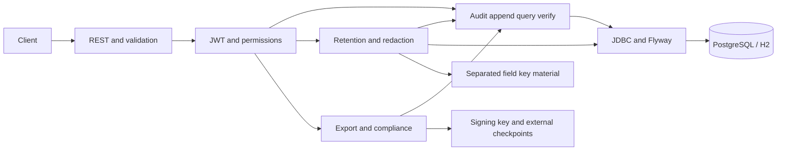

# Architecture baseline

Status: M1 baseline, authorized for foundation by user on 2026-10-28. Business behavior below is planned, not implemented. See requirements, ADRs, and milestone evidence for current status.

## Components and dependencies

One Java 21 / Spring Boot 4.1.0 Maven application. Spring MVC handles REST, Bean Validation checks requests, Spring JDBC provides explicit SQL and transactions, Flyway owns migrations, Spring Security Resource Server will validate JWTs, Springdoc supplies OpenAPI/Swagger, and Boot-managed JUnit supplies tests. PostgreSQL is the reference datastore; H2 in PostgreSQL mode is a disposable local/test convenience.

Packages will separate `api`, `security`, `audit`, `lifecycle`, `reporting`, and `persistence`. M1 creates bootstrap/security only. Keys/checkpoint trust must have access boundaries separate from event mutation privileges; the local prototype's key store is not an enterprise KMS.

## Persistence model

| Entity | Planned fields and constraints | Lifecycle |
| --- | --- | --- |
| chain_head | singleton chain_id=1, last_sequence >=0, last_hash 64 hex characters | Initialized in M1; locked/updated transactionally in M2 |
| audit_event | unique event_id UUID, unique positive sequence, event_type, actor_id, resource_type/id, occurred_at, ingested_at, schema_version, canonical_bytes, payload representation, previous_hash, record_hash | Insert/read only through service; added in M2 |
| event_archive | event_id unique FK, archived_at, policy version, operation ID | Separate lifecycle metadata in M5 |
| payload_key | event_id + field path + key version, independently protected key material/status | Added with redactable ingestion representation and erased in M5 |
| lifecycle_action | action ID/type, target IDs/paths, reason, operator, policy version, timestamp, linked administrative event | Transactionally coordinated with archival/redaction in M5 |

Prefer SQL-standard types supported by both databases. Exact PostgreSQL binary/text mappings and indexes belong to the M2 migration. Index actor/sequence, resource type+ID/sequence, event type/sequence, and occurrence time as justified by query plans. Runtime privileges differ from schema-owner migration credentials before deployment; Compose's local owner account is not a production permission model.

## Append and chain contract

1. Validate request, payload limits, and configured sensitive paths. Assign UUID and UTC ingestion time; preserve supplied occurrence time or use server time.
2. Encrypt selected sensitive fields before canonicalization (final design and tests required before ingestion is accepted as complete). Ordinary fields remain visible.
3. Begin transaction, lock singleton chain head, allocate `last_sequence + 1`.
4. Encode a versioned canonical envelope including identity, sequence, event fields, both timestamps, protected payload representation, and previous hash. JSON object keys sorted recursively; array order preserved; numeric normalization, UTF-8 encoding, and timestamp precision fixed by golden vectors in M2. Reject unsupported/ambiguous numeric input rather than hashing inconsistent encodings.
5. Compute SHA-256 with a version/domain prefix and unambiguous framing. Store exact canonical bytes plus searchable fields and hash, then update head and commit atomically. Rollback must not leave a gap/head advance.

Genesis is 64 zero hex characters at sequence zero. A single `record_hash` commits event content and predecessor; this is the record's own content hash as well as the chain link. M2 specifies exact framing and whether an additional content digest is useful; it must not weaken the predecessor commitment. No serializer-default or locale-dependent hashing.

Encryption must be stable at rest: randomized ciphertext is generated once at ingestion and then retained byte-for-byte. Planned AES-256-GCM, fresh nonce and per-field key, with associated data binding event ID/path/version. Do not store a plaintext digest of a sensitive field (dictionary-guessing exposure). M2 may introduce the protected representation; M5 completes key lifecycle and user-facing redaction. A later redaction must not require rewriting previously hashed plaintext.

## Query and verification

Queries use parameterized SQL, combined filters, bounded sequence cursors and a fixed upper-sequence snapshot marker. Time semantics are `[from,to)` on occurrence time. Default excludes archived entries; authorized opt-in includes them. Do not log payloads or tokens.

`GET /audit/verify` obtains a repeatable-read consistent snapshot of head and all events in sequence order. Recompute content hashes from stored canonical bytes, compare decoded fields with query columns, check sequence continuity, genesis, predecessor links, and final head. Return `intact`, `checkedCount`, snapshot head, and first inconsistency with sequence/event ID where available. Violation vocabulary will include CONTENT_HASH_MISMATCH, INDEX_FIELD_MISMATCH, PREVIOUS_HASH_MISMATCH, SEQUENCE_GAP, and HEAD_MISMATCH. For a missing record, report the expected missing sequence; there may be no surviving event ID.

Archival never removes immutable evidence from full-chain traversal. Full verification is O(n); streaming and repeatable-read duration are explicit prototype limits. A timeout/error is not a successful integrity result. The first inconsistency is the first observed break, not proof of which record an attacker originally changed.

## Retention and privacy

Archive records older than configured ingestion-time cutoff with a recorded policy version, operator, and reason. Use batches, idempotent lifecycle commands, and append administrative events. Keep original chain content intact. Excluding archived records from queries must not exclude them from verification or required export proof.

Redaction removes the key for an explicitly protected payload path, exposing a redaction marker on reads while retaining ciphertext committed by the chain. Redaction is irreversible within the active store, and requires human-approved operation context before destructive execution against actual data. Backups/caches/replicas and exported copies limit erasure claims. Unencrypted metadata and fields outside the allowlist are not erasable with this scheme. Separate lifecycle actions from event update APIs.

## Export verification and trust

Bundle includes format/hash/canonicalization versions, filter, export time, snapshot head, selected canonical events (protected payload retained), all intervening chain headers sufficient to verify links, and signed manifest covering the bundle digest and membership list. Headers for unselected events disclose minimal metadata/digests, not plaintext payloads. Provide an independent Java verifier with no running service dependency.

This proves included content has not changed since export under the trusted signing key. Sparse proofs alone cannot prove the filter omitted no matching events, and an embedded public key alone is not a trust anchor. Recipient pins signing identity out of band. Decrypted sensitive values are excluded from baseline export. Key rotation, revocation, trusted external checkpoints, and archival-key availability must be documented and exercised within the chosen prototype boundary.

## API and access policy (planned)

| Operation | Permission | Contract |
| --- | --- | --- |
| POST /audit/events | AUDIT_WRITE | 201 created; validation errors 400/413 |
| GET /audit/events and /{eventId} | AUDIT_READ | 200 paginated/result, 404 missing |
| GET /audit/verify | AUDIT_VERIFY | 200 verification result even when chain broken; execution failure 5xx |
| POST /audit/retention/runs | AUDIT_LIFECYCLE | Reason/policy required; audited archival result |
| POST /audit/events/{eventId}/redactions | AUDIT_LIFECYCLE | Explicit paths/reason; audited key erasure |
| GET /audit/exports | AUDIT_EXPORT | Bounded bundle by actorId or resourceId; resourceType optional disambiguation |
| GET /audit/compliance/access-report | AUDIT_COMPLIANCE | Restricted account-access summary without payload by default |

Validate JWT signature algorithm, issuer, audience, expiry/not-before, and map explicit claims to authorities. Do not build a home-grown identity provider. M1 denies all access except GET health and disables docs; M4 enables protected API/docs and supplies local test-token guidance. Use consistent problem-detail errors without sensitive values. Limit verification/export concurrency and input sizes before final readiness.

## Security and production limits

Hash chains reveal tampering relative to preserved evidence. A privileged attacker who rewrites all event hashes and chain head can evade database-only checks; a signed checkpoint retained outside the database provides a stronger reference. Whole-database rollback/truncation requires that independent reference. Cryptographic and verification claims do not imply regulatory certification, complete upstream reporting, or prevention of all database modification.

Single-chain throughput, large export headers, long verification transactions, local key storage, and external checkpoint operations are deliberate trade-offs. See `threat-model.md` and ADRs. No Kafka, frontend, distributed consensus, production KMS, or autonomous external publication is part of the approved prototype.
