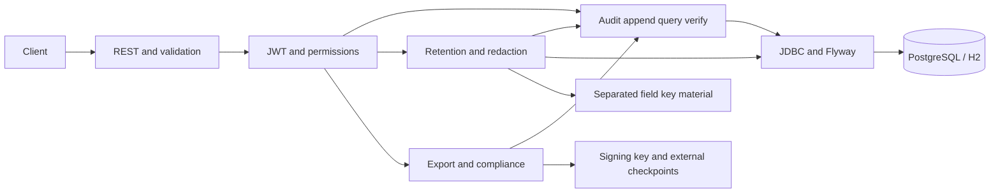

# Architecture baseline

Status: M1-M8 engineering deliverables implemented/validated locally under separate user authorizations on 2026-10-28. Ingestion, schema/chaining, queries, verification, JWT permissions, protected OpenAPI/Swagger and PostgreSQL runtime grants are implemented. Audited retention and redaction are implemented; signed export and its independent verifier are implemented; bounded metadata-only account-access reporting is implemented. See encoding/read/security contracts, ADRs and milestone evidence for exact behavior and limits.

## Components and dependencies

One Java 21 / Spring Boot 4.1.0 Maven application. Spring MVC handles REST, the strict event parser enforces input constraints, Spring JDBC provides explicit SQL/transactions, Flyway owns migrations, Spring Security Resource Server validates JWTs, Springdoc supplies protected OpenAPI/Swagger, and Boot-managed JUnit supplies tests. PostgreSQL is the reference datastore; H2 PostgreSQL mode is a disposable convenience with no equivalent role-hardening claim.

Packages separate api, security, audit and persistence; lifecycle is implemented; export is implemented; reporting is implemented. Wrapped field keys are in payload_key, master key outside PostgreSQL (ephemeral for H2). M4 restricts runtime event/key access and separates migration credentials; M5 adds scoped, audited key erasure; external checkpoints remain future work. This is not an enterprise KMS.

## Persistence model

| Entity | Fields and constraints | Lifecycle |
| --- | --- | --- |
| chain_head | singleton chain_id=1, last_sequence >=0, last_hash 64 hex characters | Initialized in M1; locked/updated transactionally in M2 |
| audit_event | unique event_id UUID, unique positive sequence, event_type, actor_id, resource_type/id, occurred_at, ingested_at, schema_version, canonical_bytes, payload representation, previous_hash, record_hash | Insert/read only through service; added in M2 |
| event_archive | event_id unique FK, archived_at, operation ID (policy committed in action) | Separate lifecycle metadata in M5 |
| payload_key | event_id + field path + key version, independently wrapped field key material | Added with redactable ingestion representation and erased in M5 |
| payload_redaction | event_id + field_path primary key, operation ID, redacted_at | M5 audited erasure marker |
| lifecycle_action | action ID/type, target IDs/paths, reason, operator, policy version, timestamp, linked administrative event | Transactionally coordinated with archival/redaction in M5 |

V2 uses BYTEA (also supported by H2 PostgreSQL mode), TEXT, UUID and TIMESTAMP(6) WITH TIME ZONE. Indexes cover actor/sequence, resource type+ID/sequence, event type/sequence and occurrence time; M8 local measurements are in performance.md; production tuning remains workload-dependent. PostgreSQL-only V3 grants audit_runtime SELECT/INSERT on events/keys and column-limited head updates; audit_migrator owns schema/tables. Fresh-cluster bootstrap revokes public creation/TEMP privileges and supplies separate logins. See security-and-api.md for existing-volume and startup-secret boundaries.

## Append and chain contract

1. Validate request, payload limits, and configured sensitive paths. Assign UUID and UTC ingestion time; preserve supplied occurrence time or use server time.
2. Encrypt selected sensitive fields before canonicalization (final design and tests required before ingestion is accepted as complete). Ordinary fields remain visible.
3. Begin transaction, lock singleton chain head, allocate `last_sequence + 1`.
4. Encode a versioned canonical envelope including identity, sequence, event fields, both timestamps, protected payload representation, and previous hash. JSON object keys sorted recursively; array order preserved; numeric normalization, UTF-8 encoding, and timestamp precision fixed by golden vectors in M2. Reject unsupported/ambiguous numeric input rather than hashing inconsistent encodings.
5. Compute SHA-256 with a version/domain prefix and unambiguous framing. Store exact canonical bytes plus searchable fields and hash, then update head and commit atomically. Rollback must not leave a gap/head advance.

Genesis is 64 zero hex characters at sequence zero. A single `record_hash` commits event content and predecessor; this is the record's own content hash as well as the chain link. M2 specifies exact framing and whether an additional content digest is useful; it must not weaken the predecessor commitment. No serializer-default or locale-dependent hashing.

Encryption must be stable at rest: randomized ciphertext is generated once at ingestion and then retained byte-for-byte. Implemented AES-256-GCM, fresh nonce and per-field key, with associated data binding event ID/path/version. Do not store a plaintext digest of a sensitive field (dictionary-guessing exposure). M2 introduced the protected representation; M5 implements audited key erasure and user-facing markers. A later redaction must not require rewriting previously hashed plaintext.

## Query and verification

Queries use parameterized SQL, combined filters, signed bounded sequence cursors and a fixed upper-sequence/head-hash marker. Time semantics are `[from,to)` on occurrence time. Returned protected values are restored only after row validation; unexplained missing keys are 503. M5 validates erasure evidence before returning markers; archives are excluded unless includeArchived=true with both READ and LIFECYCLE. Cursor v2 binds archive mode and invalidates v1 cursors. Do not log payloads or tokens.

`GET /audit/verify` obtains a consistent snapshot of head and all events in sequence order. ReadSnapshot uses PostgreSQL REPEATABLE_READ and H2 SERIALIZABLE (H2 REPEATABLE_READ admitted phantom rows in the concurrency test). Separate read-only transactions preserve the guarantee even if a caller has weaker isolation; append isolation is unchanged. Recompute exact content hashes, compare query columns, then check sequence continuity, genesis, predecessor links and final head. Return `intact`, `checkedCount`, snapshot head and first inconsistency with sequence/event ID where available. Types include CONTENT_HASH_MISMATCH, INDEX_FIELD_MISMATCH, PREVIOUS_HASH_MISMATCH, SEQUENCE_GAP, HEAD_MISMATCH, MALFORMED_CONTENT UNSUPPORTED_SCHEMA_VERSION and LIFECYCLE_MISMATCH. Missing records report expected sequence and null event ID. Operational failures return safe 503, not an integrity-success response.

Archival never removes immutable evidence from full-chain traversal. Full verification is O(n); streaming and repeatable-read duration are explicit prototype limits. A timeout/error is not a successful integrity result. The first inconsistency is the first observed break, not proof of which record an attacker originally changed.

## Retention and privacy

Archive records older than configured ingestion-time cutoff with a recorded policy version, operator, and reason. Use batches, idempotent lifecycle commands, and append administrative events. Keep original chain content intact. Excluding archived records from queries must not exclude them from verification or required export proof.

Redaction removes the key for an explicitly protected payload path, exposing a redaction marker on reads while retaining ciphertext committed by the chain. Redaction is irreversible within the active store, and requires human-approved operation context before destructive execution against actual data. Backups/caches/replicas and exported copies limit erasure claims. Unencrypted metadata and fields outside the allowlist are not erasable with this scheme. Separate lifecycle actions from event update APIs.

## Export verification and trust (M6)

Bundle includes format/hash/canonicalization versions, filter, export time, snapshot head, selected canonical events (protected payload retained), all intervening chain headers sufficient to verify links, and signed manifest covering the bundle digest and membership list. Headers for unselected events disclose minimal metadata/digests, not plaintext payloads. Provide an independent Java verifier with no running service dependency.

This proves included content has not changed since export under the trusted signing key. Sparse proofs alone cannot prove the filter omitted no matching events, and an embedded public key alone is not a trust anchor. Recipient pins signing identity out of band. Decrypted sensitive values are excluded from baseline export. Key rotation, revocation, trusted external checkpoints, and archival-key availability must be documented and exercised within the chosen prototype boundary.

## API and target access policy

Write/read/verification are now enabled through validated JWTs and the permissions below. M5 lifecycle routes are enabled; M6 signed export is enabled; M7 access reporting is enabled through AUDIT_COMPLIANCE. OpenAPI/Swagger including HTML/config/assets requires separate AUDIT_DOCS.

| Operation | Permission | Contract |
| --- | --- | --- |
| POST /audit/events | AUDIT_WRITE | 201 created; validation errors 400/413 |
| GET /audit/events and /{eventId} | AUDIT_READ | 200 paginated/result, 404 missing |
| GET /audit/verify | AUDIT_VERIFY | 200 verification result even when chain broken; execution failure 5xx |
| POST /audit/retention/runs | AUDIT_LIFECYCLE | Operation ID/reason required; server policy; audited archival result |
| POST /audit/events/{eventId}/redactions | AUDIT_LIFECYCLE | Operation ID, paths/reason, approval reference and ERASE_FIELD_KEYS confirmation; audited key erasure |
| GET /audit/exports | AUDIT_EXPORT | Bounded bundle by actorId or resourceId; resourceType optional disambiguation |
| GET /audit/compliance/access-report | AUDIT_COMPLIANCE | Restricted account-access summary without payload by default |

M4 pins RS256/RSA >=2048, validates issuer/audience and required subject/time claims with 30-second skew, and maps only recognized permissions strings. Bearer headers only, stateless, safe auth/domain errors; GET health is public. No server identity-provider/token endpoint exists. The actual developer source launcher is tested independently. Full verification has a per-process semaphore (default 2, 429 on exhaustion); M6 adds a separate export semaphore (default 2) and hard format bounds and measured budgets remain M8. Protected browser documentation requires bearer-header support; see the security contract.

## Security and production limits

Hash chains reveal tampering relative to preserved evidence. A privileged attacker who rewrites all event hashes and chain head can evade database-only checks; a signed checkpoint retained outside the database provides a stronger reference. Whole-database rollback/truncation requires that independent reference. Cryptographic and verification claims do not imply regulatory certification, complete upstream reporting, or prevention of all database modification.

Single-chain throughput, large export headers, long verification transactions, local key storage, and external checkpoint operations are deliberate trade-offs. See `threat-model.md` and ADRs. No Kafka, frontend, distributed consensus, production KMS, or autonomous external publication is part of the approved prototype.

## Implemented M5 lifecycle boundary

See [lifecycle.md](lifecycle.md) and [ADR-007](decisions/ADR-007-audited-lifecycle-capabilities.md). V4 adds action/archive/redaction evidence; PostgreSQL V5 exposes a single-event/single-path erasure function with restricted execution and fixed search_path. Direct key DELETE stays denied. Commands lock the shared chain head and commit immutable administrative evidence, markers and erasure atomically. Operation IDs bind normalized intent and JWT subject; exact retries return their original receipt, conflicts return 409. Internal administrative records are excluded from retention and redaction targets.

Default retention is P90D/policy v1/batch 100; eligibility is strict ingestion-time less than cutoff. Erasure requires an operator-supplied approval reference, which is not verified against an external approval system. Erasure covers the active transactional store only; WAL, backups, replicas, prior snapshots/in-flight reads and previously disclosed values may remain recoverable. No physical erasure or legal-compliance certification is claimed. Lifecycle state may change between query pages. Proof validation can repeat work across targets; performance measurement remains M8.

## Implemented M6 export boundary

[Export contract](exports.md) and [ADR-008](decisions/ADR-008-bounded-independent-exports.md) freeze the signed ZIP manifest/body format. GET /audit/exports requires actorId or resourceId with AUDIT_EXPORT; archive opt-in adds LIFECYCLE. Each snapshot validates all source records/lifecycle evidence, emits selected protected canonical content and minimal genesis-to-head headers, and signs exact manifest bytes using a separate configured RSA key. No decryption keys or restored protected values leave through export. Missing signing configuration yields 503, malformed configuration fails startup. No migration or database grant changes are needed.

Maven packages a dependency-free Java 21 verifier JAR. Recipients pin a public key out of band. Verification authenticates the manifest/body, recomputes selected hashes, validates selected envelope/header fields, links/order/membership and final head. Hidden-payload headers and lifecycle status are signed assertions; filter completeness, upstream truth and physical erasure are not proved. Export defaults to 10000 whole-chain headers, 1000 selected events, 16 MiB body and two concurrent requests; excess returns 413/429, never partial output. Range/checkpoint formats, external checkpoint operation and M7 reporting are outside M6.

## Implemented M7 report boundary

[Access-report contract](access-report.md) and [ADR-009](decisions/ADR-009-bounded-account-access-report.md) refine Scenario C without changing canonical event schema or adding a projection table. report.AccessReportQuery/Service and the controller stream parameterized CLIENT_ACCOUNT/recognized-action candidates under ReadSnapshot. Require from/to (default maximum 31 days), validate stored commitments, read only a supported plaintext outcome, and project eight metadata fields. No field keys or decryption path are used. Unsupported/protected outcomes are counted as exclusions; other source types are outside declared scope.

AUDIT_COMPLIANCE opens only this report; archive opt-in additionally requires LIFECYCLE. Report cursors reuse the HMAC implementation with a distinct purpose/context, preserving ordinary query v2 compatibility while preventing cross-endpoint replay. Range/filter/limit/archive/version and upper-head identity are bound. Default scan budget 1000 and concurrency two return 413/429 on excess, with no partial report. Per-request scan/exclusion counts include lookahead and are not period totals. The report is neither a full-chain verification nor a signed M6 export, and cannot certify legal compliance, independently establish actor identity or detect upstream omissions. M8 local readiness evidence is delivered; human acceptance/submission remain pending.

## M8 readiness and maintained dependency boundary

The opt-in readiness profile exercises real HTTP A/B/C, controlled administrator-only synthetic tampering, actual offline export verification, fresh packaged H2 startup and a 1000-event measured baseline against the real PostgreSQL runtime pool. The final patched run passed 210 checks. Boot stays 4.1.0; explicit compatible security overrides and the aligned Swagger WebJar version are in pom.xml and filtered application.yml. Dependency-Check 13.0.0 resolves older import-schema limitations; cache/output stay ignored, failures are enforced, and data freshness/absent OSS Index credentials are recorded. No migration/hash-format change was required. Offline CLI file reads now enforce bounds during the read.

See security-review.md, performance.md, walkthrough.md and validation/milestone-8.md. Local PostgreSQL 16.3/H2 proof is distinct from configured 17.6/remote deployment. Synthetic measurements do not promise scale or a production SLO; external checkpoint operation, tenant scope and real key/backup operations remain beyond this prototype. Owner acceptance/attestation and submission are pending.
